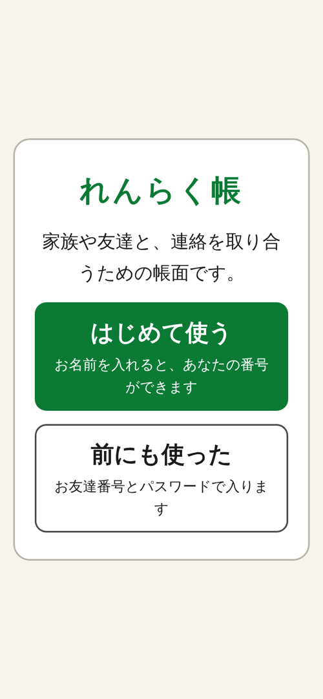
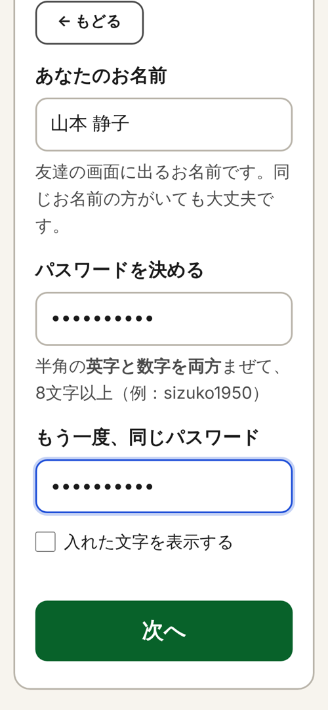
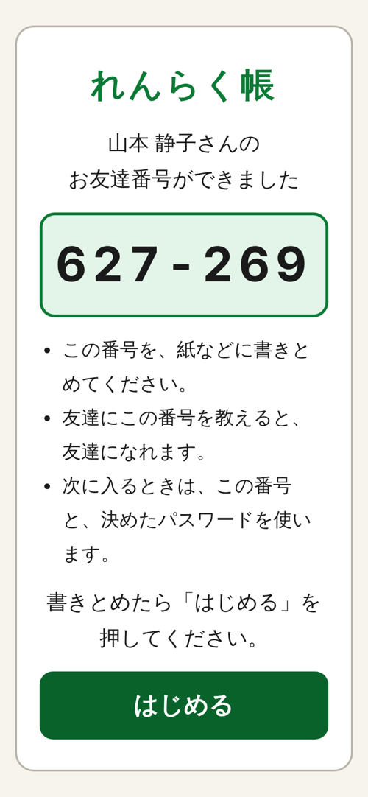
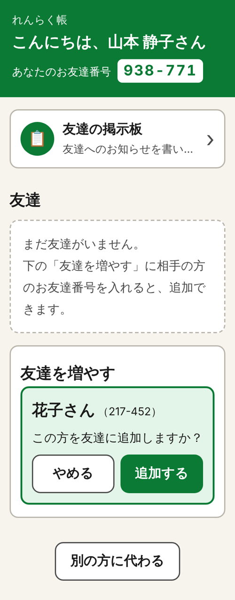
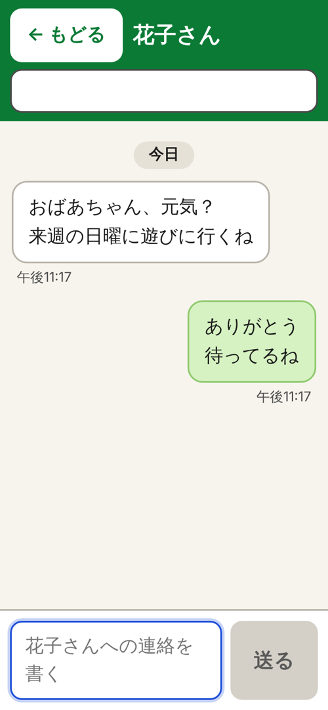
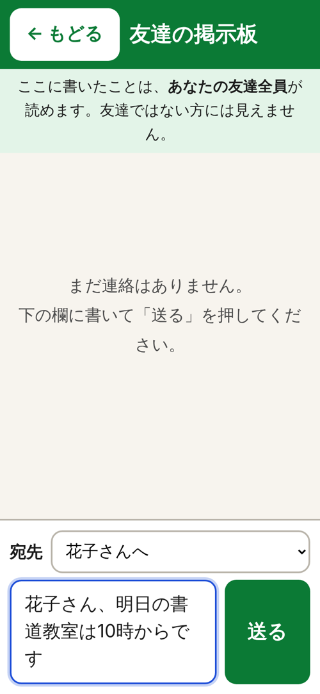
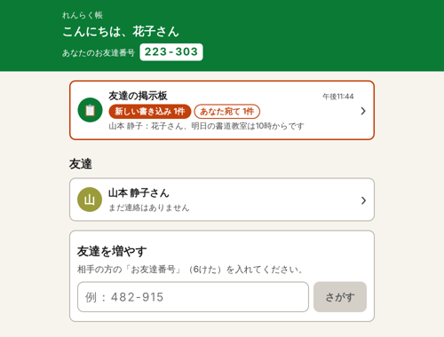
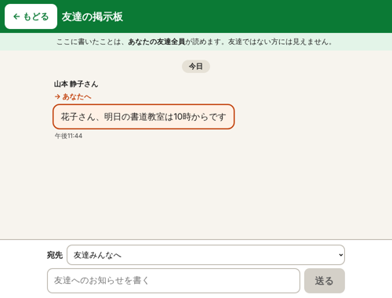

# れんらく帳

スマートフォンに慣れていない高齢の方でも使えることを目標にした、連絡用のチャットアプリです。
一対一の連絡、友達向けの掲示板、友達の追加・削除ができます。

想定した利用者は docs/PERSONA.md に、設計で考えたことは docs/DESIGN.md にまとめています。

## 使用技術

- フロントエンド：Next.js 15（TypeScript）
- バックエンド：FastAPI
- データベース：SQLite（SQLAlchemy 経由）
- リアルタイム通信：WebSocket（FastAPI の標準機能）

## 画面

| 入口 | 登録 | 番号の発行 | 友達の追加 |
|---|---|---|---|
|  |  |  |  |

| 一対一 | 掲示板（宛先を選ぶ） | はじめの画面 | 自分宛ての書き込み |
|---|---|---|---|
|  |  |  |  |

## 主な機能

- 名前とパスワードで登録すると、6けたの「お友達番号」が発行されます。2回目以降は番号とパスワードで入ります。
- 相手の番号を入れると名前が表示され、確認してから友達に追加できます。追加するとお互いが友達になります。
- 友達とは一対一でやり取りできます。新しい連絡は、はじめの画面に件数で表示されます。
- 掲示板には、自分と友達の書き込みだけが表示されます。書くときに宛先として友達を1人選ぶこともできます。
- 連絡はリロードしなくても相手の画面に届きます。

高齢の方を想定したので、文字とボタンを大きくし、画面の数を減らし、カタカナの言葉はなるべく使わないようにしました。

## 起動方法

Python 3.11 以上、Node.js 20 以上が必要です。

バックエンド：

```bash
cd backend
python3 -m venv .venv
source .venv/bin/activate        # Windows (PowerShell) の場合: .venv\Scripts\Activate.ps1
pip install -r requirements.txt
uvicorn app.main:app --reload --port 8000
```

起動すると `backend/chat.db` が作られます。API の一覧は http://localhost:8000/docs で見られます。

フロントエンド（別のターミナルで）：

```bash
cd frontend
npm install
npm run dev
```

http://localhost:3000 を開いて「はじめて使う」から登録してください。動作を確認するときは、シークレットウィンドウなどでもう1人登録し、片方からもう片方の番号を入れて友達にすると、やり取りを試せます。

### うまく動かないとき

- Ubuntu / WSL で `python3 -m venv` が失敗する場合は、`sudo apt install python3-venv` を実行してください。
- WSL で、プロジェクトを `/mnt/c/...` に置いたまま `pip install` や `npm install` をすると、とても時間がかかります。`~/` 以下にコピーしてから実行してください。
- 以前の版の `chat.db` が残っているとエラーになるので、削除してから起動してください。

### 設定（任意）

| 環境変数 | 既定値 | 内容 |
|---|---|---|
| `CHAT_DATABASE_URL` | `sqlite:///./chat.db` | DB の接続先 |
| `CHAT_CORS_ORIGINS` | `http://localhost:3000` | フロントの URL |
| `CHAT_FRIEND_CODE_DIGITS` | `6` | お友達番号の桁数 |
| `CHAT_PASSWORD_ITERATIONS` | `600000` | パスワードのハッシュ化の回数 |
| `NEXT_PUBLIC_API_BASE_URL` | `http://localhost:8000` | フロントから見た API の URL |

### テスト

```bash
cd backend && pytest
cd frontend && npm run lint && npm run build
```

## フォルダ構成

```
backend/app/
  main.py         アプリの起動、ルーターの登録
  models.py       テーブル定義
  schemas.py      API の入出力の形
  routers/        API の入口（auth, friends, rooms, ws）
  services/       処理の本体（auth, passwords, friends, chat, realtime）
backend/tests/    API のテスト
frontend/src/
  app/            画面（/start, /, /talk/[roomId]）
  components/     画面の部品
  hooks/          ログイン状態、WebSocket、やり取りのデータ
  lib/            API の呼び出し、型、表示の整形
docs/             ペルソナと設計メモ
```

## API

| メソッド | パス | 内容 |
|---|---|---|
| POST | `/api/auth/register` | 登録（名前・パスワード） |
| POST | `/api/auth/resume` | ログイン（番号・パスワード） |
| GET | `/api/auth/me` | 自分の情報 |
| POST | `/api/auth/logout` | ログアウト |
| GET | `/api/home` | はじめの画面に出す内容（掲示板・友達・未読数） |
| GET | `/api/users/by-code/{番号}` | 番号の持ち主の名前（追加前の確認用） |
| POST | `/api/friends` | 友達の追加 |
| DELETE | `/api/friends/{user_id}` | 友達の削除 |
| GET | `/api/rooms/{id}` | 部屋の情報 |
| GET | `/api/rooms/{id}/messages` | 連絡の一覧（30件ずつ、`before_id` で前の分） |
| POST | `/api/rooms/{id}/messages` | 連絡を送る（掲示板では `mention_user_id` で宛先を指定） |
| POST | `/api/rooms/{id}/read` | 既読にする |
| WS | `/ws?token=` | 新しい連絡などを受け取る |

## 未対応のこと

- パスワードを忘れたときの再設定はありません。メールアドレスや電話番号を登録しない作りにしたためです。
- ログインや番号検索に回数制限をかけていないので、総当たりへの対策ができていません。
- パスワードのルール（英字と数字を含む8文字以上）は安全性を優先して決めたので、高齢の方にとって使いやすいかは確かめられていません。
- 掲示板の宛先は目立たせるためのもので、宛先以外の友達からも見えます。
- テーブルの変更には `create_all` を使っていて、マイグレーションの仕組みは入れていません。
- ログイン状態のトークンは localStorage に保存しています。本番では HttpOnly Cookie にしたほうが安全です。
